# RISC-V Edge AI Workshop (VSD-IAT) — Summary & Lab Notes

> **Train → Quantize → Deploy → Benchmark** — building neural networks that run on a SiFive RISC-V microcontroller with only **16 KB of RAM**.

These are my notes and screenshots from the **RISC-V Edge AI workshop by VSD (VLSI System Design) / VSD-IAT**, a 10-day cloud-based programme (2–11 October 2026) built around the **VSDSquadron PRO** board. The repo walks through the whole arc of the workshop: why AI on a bare-metal MCU is hard, the board, regression and classification from scratch, fitting an MNIST classifier into 16 KB, quantization, neural networks, and the hands-on Freedom Studio / QEMU flow.

> **Note:** This is an unofficial personal summary. Slides, diagrams and course material belong to VSD and the original authors credited in [References](#references). Screenshots are included for study and discussion only.

---

## At a glance

| | |
|---|---|
| **Workshop** | RISC-V EdgeAI — "RISC-V Edge AI with VSDSquadron Pro" |
| **Organiser** | VSD – VLSI System Design (VSD-IAT programme) |
| **Format** | 10 days, cloud-based, live sessions on the VSD Virtual Coach platform |
| **Instructors** | Kunal Ghosh, Ankit Mawle, Dhanvanti Bhavsar |
| **Hardware** | VSDSquadron PRO (SiFive FE310-G002); VSDSquadron Mini shown for comparison |
| **Software** | SiFive Freedom Studio 3.1.1, Google Colab (Python / NumPy / scikit-learn), Desmos, Zadig (USB driver), QEMU |
| **Hard constraint** | 16 KB data RAM — every model has to fit |
| **Prerequisites** | Python, C/C++, basic RISC-V, "a lot of maths" (algebra and vectors — no advanced calculus) |

### Workshop modules → where they are in this README

| # | Official module | Section |
|---|---|---|
| 1 | Edge AI Orientation & Hardware Primer | [1](#1-why-edge-ai-on-risc-v) · [2](#2-the-hardware-vsdsquadron-pro) |
| 2 | ML Foundations (Regression & Optimization) | [3](#3-ml-foundations-regression--gradient-descent) |
| 3 | Classification (KNN → SVM) | [4](#4-classification-knn--svm) |
| 4 | Memory-Constrained ML & Quantization | [5](#5-fitting-mnist-into-16-kb) · [6](#6-quantization-fundamentals) |
| 5 | Neural Networks on RISC-V | [7](#7-neural-networks) |
| 6 | Advanced Quantization & Deployment | [6](#6-quantization-fundamentals) · [8](#8-bitnetmcu-low-bit-neural-networks-on-hardware) |
| 7 | Capstone & Next Steps | [8](#8-bitnetmcu-low-bit-neural-networks-on-hardware) · [10](#10-key-takeaways) |

Bonus: [Section 9](#9-no-board-no-problem--running-on-qemu) covers running RISC-V code with no board, using QEMU.

## Table of contents

1. [Why Edge AI on RISC-V?](#1-why-edge-ai-on-risc-v)
2. [The hardware: VSDSquadron PRO](#2-the-hardware-vsdsquadron-pro)
3. [ML foundations: regression & gradient descent](#3-ml-foundations-regression--gradient-descent)
4. [Classification: KNN → SVM](#4-classification-knn--svm)
5. [Fitting MNIST into 16 KB](#5-fitting-mnist-into-16-kb)
6. [Quantization fundamentals](#6-quantization-fundamentals)
7. [Neural networks](#7-neural-networks)
8. [BitNetMCU: low-bit neural networks on hardware](#8-bitnetmcu-low-bit-neural-networks-on-hardware)
9. [No board, no problem — running on QEMU](#9-no-board-no-problem--running-on-qemu)
10. [Key takeaways](#10-key-takeaways)
11. [Repository layout](#repository-layout) · [References](#references)

---

## 1. Why Edge AI on RISC-V?

The workshop opens with a framing: **traditional programming vs. learning**. In classic code *you* write the rules and the behaviour is predictable — "like RISC-V assembly: clean, minimal, direct". In AI you feed the machine examples and it learns the patterns — "like a toddler learning by trial and error".

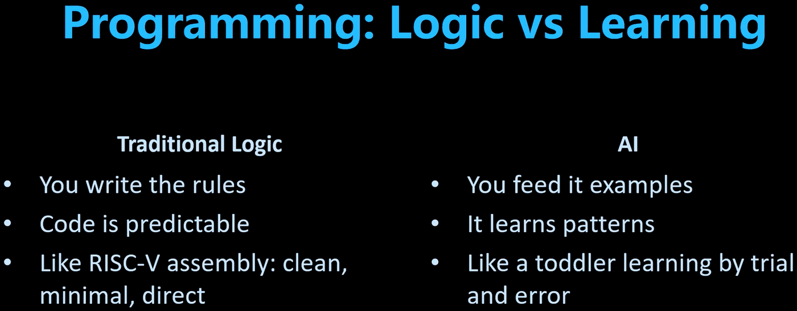
*Traditional logic vs. AI.*

The catch is that a RISC-V MCU is nothing like a Raspberry Pi. There is no Linux, no Python and no safety net — low RAM, low power, full control. The slide's comparison table sums it up:

| Feature | Raspberry Pi | RISC-V (VSD PRO) |
|---|---|---|
| OS | Full Linux | Bare-metal |
| Tools | Python, PyTorch | C, Assembly |
| AI-ready? | Yes | "Nope (but we'll change that)" |

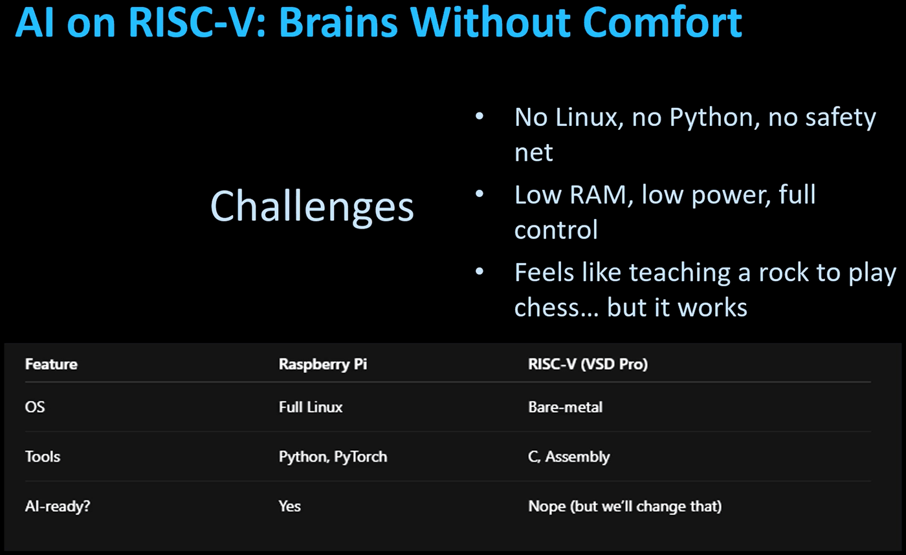
*"Feels like teaching a rock to play chess… but it works."*

### What the course is really about

- Understand AI **from the ground up** — no black-box frameworks
- Use RISC-V boards to **deploy** a model
- Learn the real constraints: **memory, timing, power**
- Build **tiny AI that thinks on the edge**

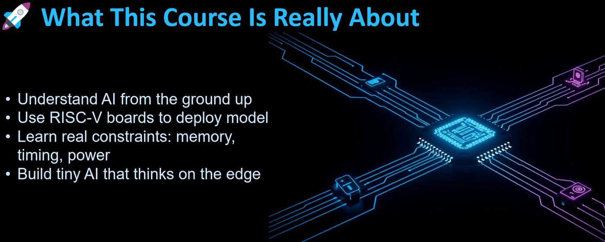

### Getting started

Install **Freedom Studio** and sign in to a **Google Colab** account. Prerequisites are Python, C++, a basic understanding of RISC-V, and "a lot of maths".

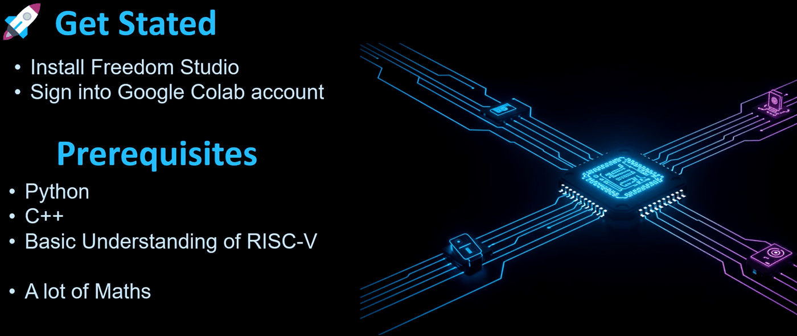

---

## 2. The hardware: VSDSquadron PRO

The **VSDSquadron PRO** is built around the **SiFive FE310-G002** — a 32-bit **RV32IMAC** core (SiFive E31 core complex) designed with IoT and edge computing in mind.

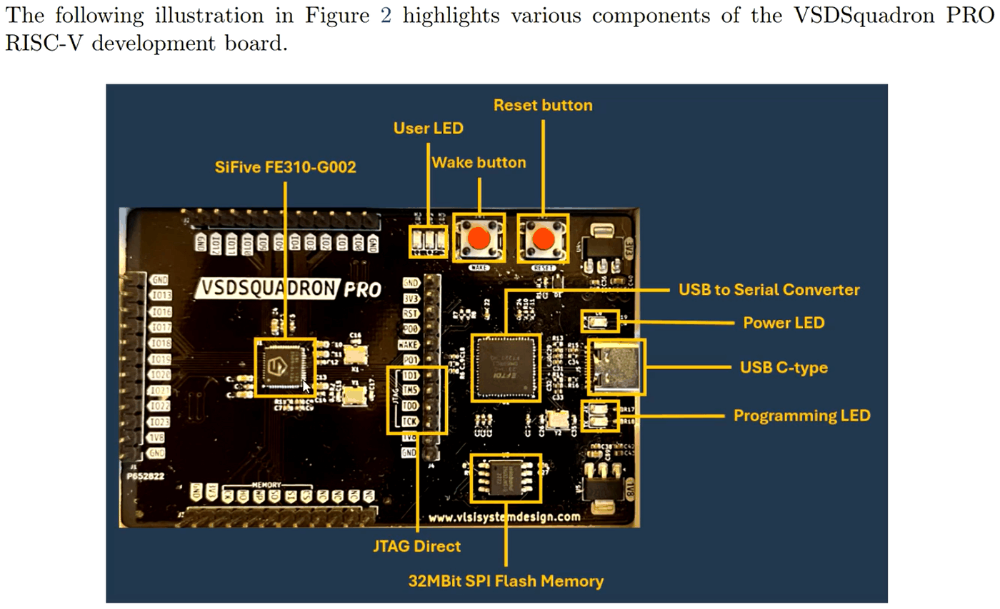
*Board layout: FE310-G002, USB-to-serial converter, USB-C, user/power/programming LEDs, reset and wake buttons, JTAG, and a 32 Mbit SPI flash.*

### Board specifications (from the getting-started guide)

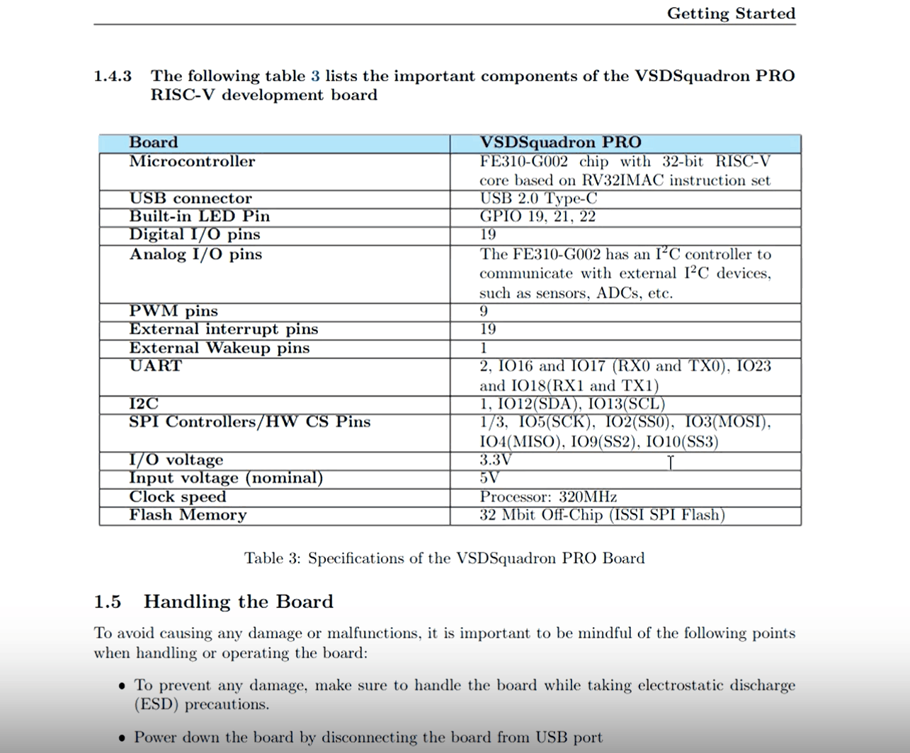

| Item | Value |
|---|---|
| Microcontroller | FE310-G002, 32-bit RISC-V core (RV32IMAC) |
| Clock | up to **320 MHz** (16 MHz on-board crystal) |
| Data memory | **16 KB data SRAM scratchpad** + 16 KB L1 instruction cache |
| Flash | 32 Mbit off-chip (ISSI SPI flash), dedicated quad-SPI (QSPI) interface |
| Digital I/O | 19 pins, 9 PWM, 19 external-interrupt pins, 1 wake-up pin |
| UART / I²C / SPI | 2 UARTs (IO16/IO17, IO23/IO18), 1 I²C (IO12 SDA, IO13 SCL), SPI with HW chip-selects |
| Voltage | 3.3 V I/O, 5 V nominal input |
| USB | USB 2.0 Type-C (program, debug and serial) |
| Built-in LED pins | GPIO 19, 21, 22 |

### Why this chip suits Edge AI

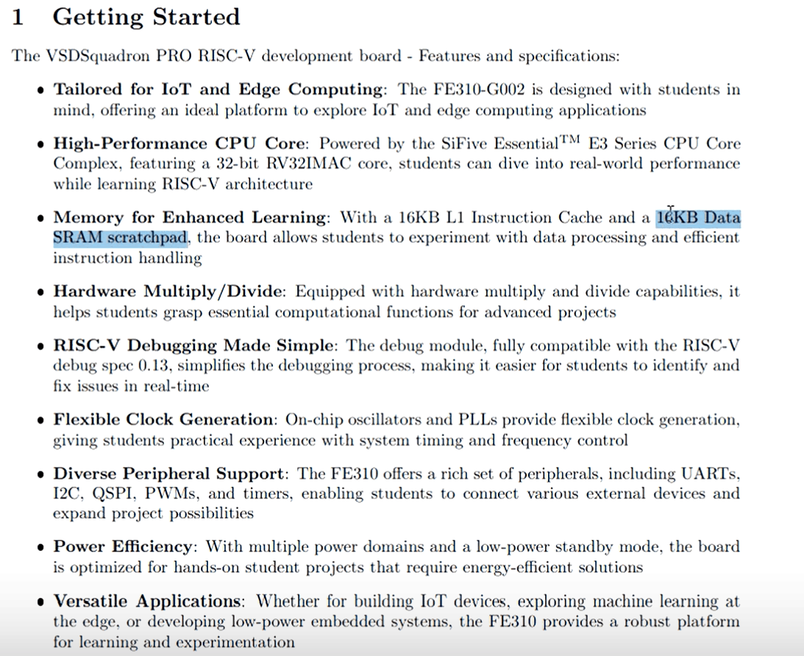

The getting-started guide highlights: hardware **multiply/divide** (important for dot products), an RISC-V debug module compliant with debug spec 0.13, flexible clock generation (on-chip oscillators and PLLs), a rich peripheral set (UART, I²C, QSPI, PWM, timers) and a low-power standby mode. The SiFive datasheet adds an always-on block (watchdog, RTC, power-management unit) and CLINT/PLIC interrupt controllers ([datasheet](https://pages.hmc.edu/harris/class/e85/old/fall24/fe310-g002-ds.pdf)).

> **The number to remember: 16 KB.** Everything — stack, heap, `.data`, buffers — has to fit in 16 KB of SRAM. Code and constants can live in the QSPI flash, which is the key to the memory tricks in [Section 5](#5-fitting-mnist-into-16-kb).

### USB driver setup (Windows)

To program the board from Windows, install **Zadig**, enable *Options → List All Devices*, select **Dual RS232-HS (Interface 0)**, choose the **libusb-win32** driver and click *Install / Reinstall Driver*.

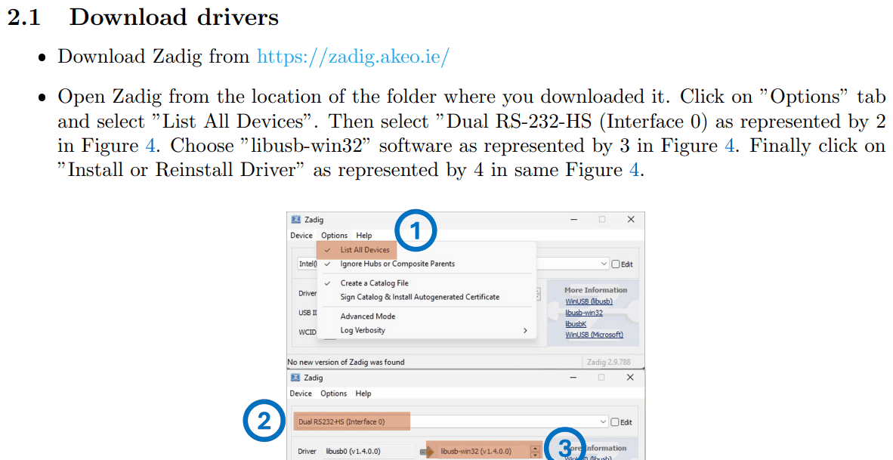

---

## 3. ML foundations: regression & gradient descent

Before touching the board, the workshop builds machine learning **from scratch** in Colab with NumPy — no `sklearn.fit()` shortcut.

### 3.1 Data → pattern

A tiny dataset (`studentscores.csv`: study **Hours** vs exam **Scores**) is loaded with pandas and plotted. The relationship is visibly linear.

| Dataset in Colab | Scatter plot |
|---|---|
| 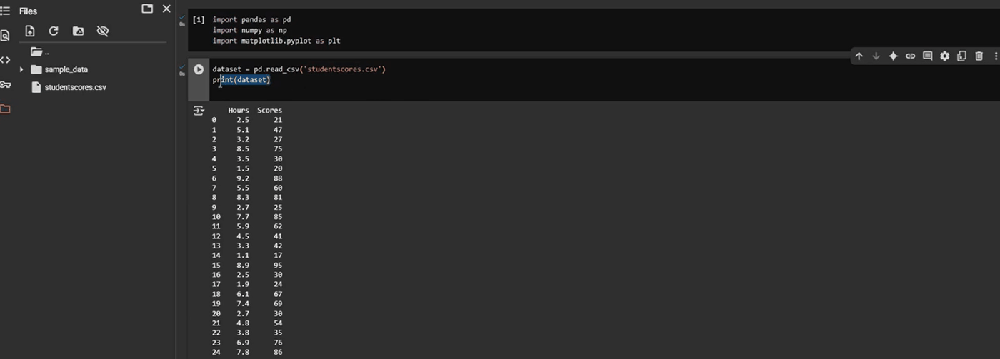 | 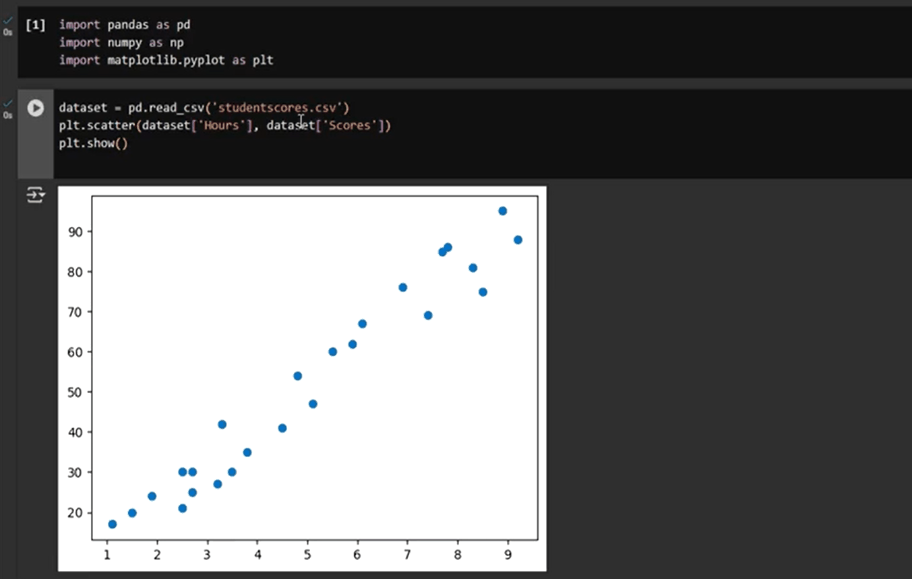 |

### 3.2 Linear regression as a Python class

The model is a `Model` class with `predict` (`X·slope + const`), `fit` and `update_weights`. Training is **gradient descent** on the mean-squared error:

```python
def predict(self, X):
    return X.dot(self.slope) + self.const

def update_weights(self):
    Y_pred = self.predict(self.X)
    dW = -(2 * (self.X.T).dot(self.Y - Y_pred)) / self.m   # ∂Loss/∂slope
    db = -2 * np.sum(self.Y - Y_pred) / self.m              # ∂Loss/∂bias
    self.slope = self.slope - self.learning_rate * dW
    self.const = self.const - self.learning_rate * db
```

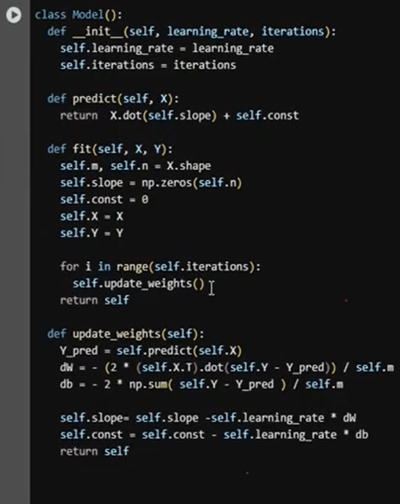

Plotting the predictions (red) on top of the real data (blue) shows how close the learned line sits to the points:

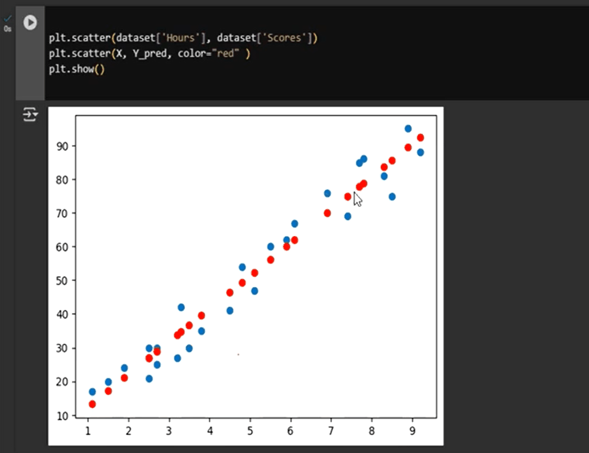

### 3.3 Watching the loss go down

Training with `learning_rate=0.01` prints the loss at every iteration. The loss falls steadily, but after only a few dozen iterations the red regression line is still *below* the high-score points — a good illustration that **learning rate × iterations** decides how far the optimiser gets.

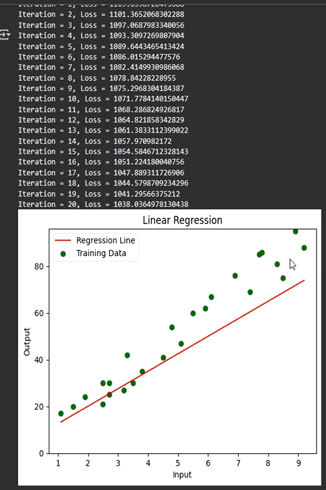

### 3.4 Underfitting, overfitting and Desmos intuition

A high-degree polynomial can pass through every training point yet swing wildly between and beyond them — the classic **overfit**. Desmos is used to *see* this next to a plain straight line.

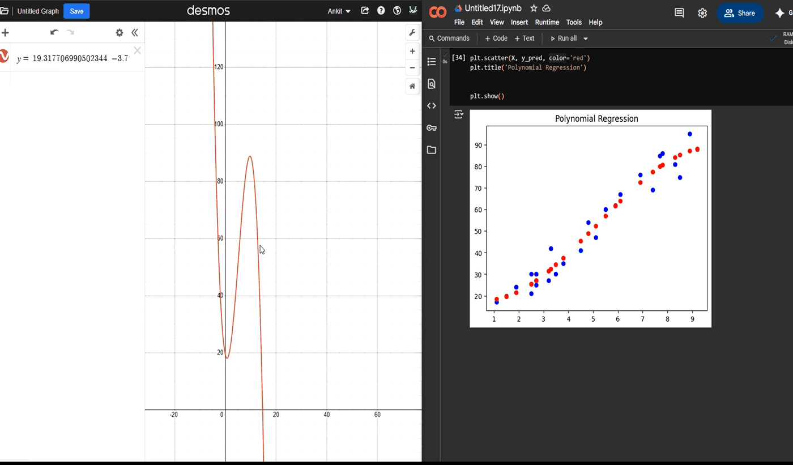

An interactive Desmos sheet ("VSD SQ Understanding ML") shows **least-squares** visually: dashed lines are the residuals, and moving the number of data points changes the fit and the *prediction error*.

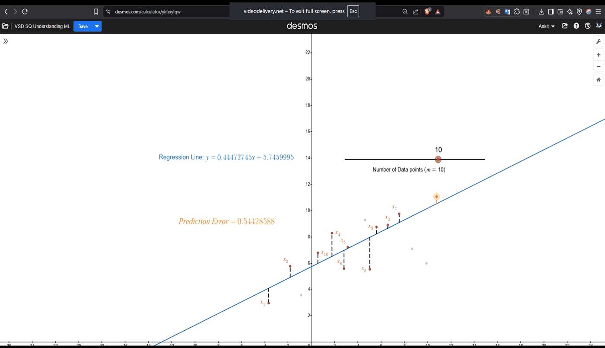
*Regression line y ≈ 0.4447x + 5.746, prediction error ≈ 0.544 for 10 data points.*

### 3.5 More inputs: the startup profit predictor

With several features (R&D spend, administration spend, marketing spend) the "line" becomes a **plane**. The plot below holds the other features fixed and shows predicted profit over R&D and marketing spend.

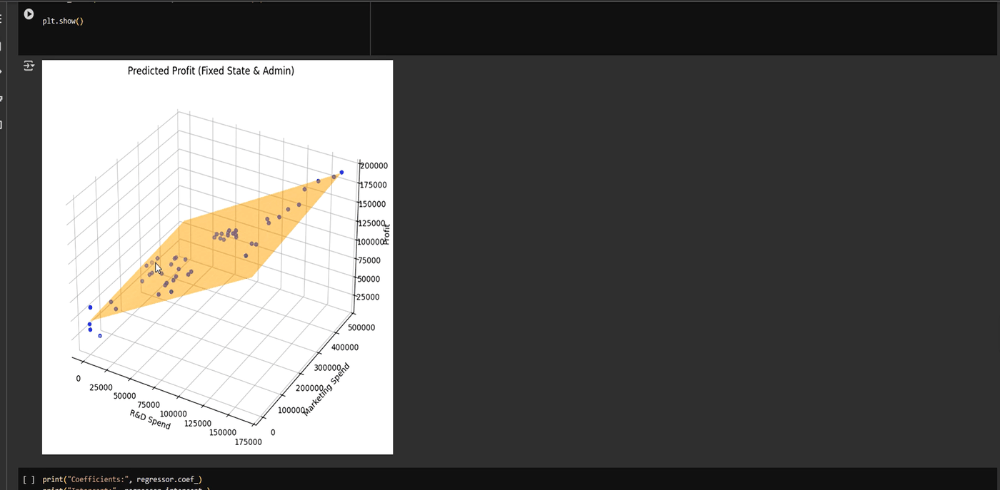

### 3.6 Python → RISC-V: the first model on the board

The trained coefficients are copied into plain **C** and compiled in Freedom Studio. At inference time a linear model is just **three multiplies, three adds and a bias** — trivial for an MCU with a hardware multiplier:

```c
#define x1 0.77884104f
#define x2 0.0293919f
#define x3 0.03471025f
#define b  42989.00816508669f

float predict(float inp1, float inp2, float inp3) {
    return x1*inp1 + x2*inp2 + x3*inp3 + b;
}

// main(): rDSpend=165349.2f, aDSpend=136897.8f, mKSpend=471784.1f
//         profit = predict(rDSpend, aDSpend, mKSpend);
```

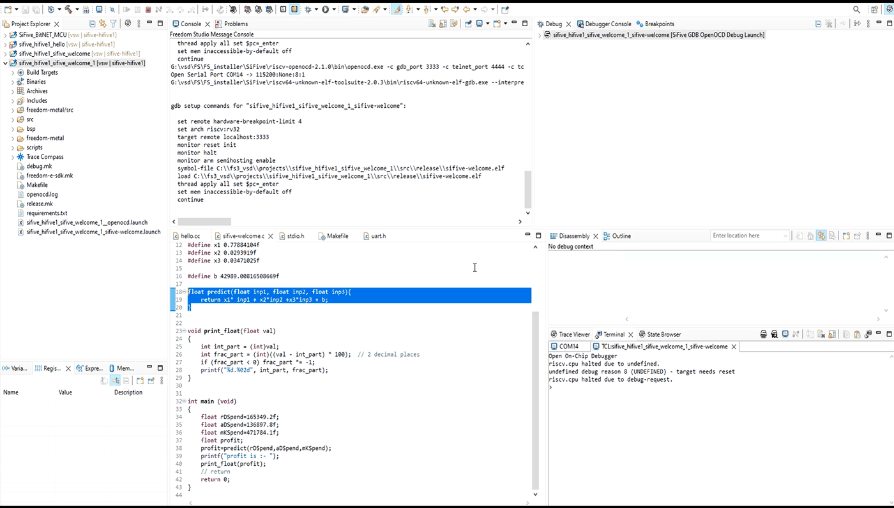
*Model trained in Python, deployed as C constants. Note the custom `print_float()` — `printf("%f")` pulls in a lot of library code on a tiny MCU, so the float is printed as integer and fractional parts.*

> **Lesson:** training is expensive and happens on a PC; **inference is cheap** and is what runs on the edge.

---

## 4. Classification: KNN → SVM

Regression predicts a number; **classification** predicts a category. The workshop uses the classic *Social Network Ads* data — `User ID, Age, EstimatedSalary, Purchased` — to predict whether a user buys.

| Dataset (spreadsheet view) | Age vs. salary, coloured by class |
|---|---|
| 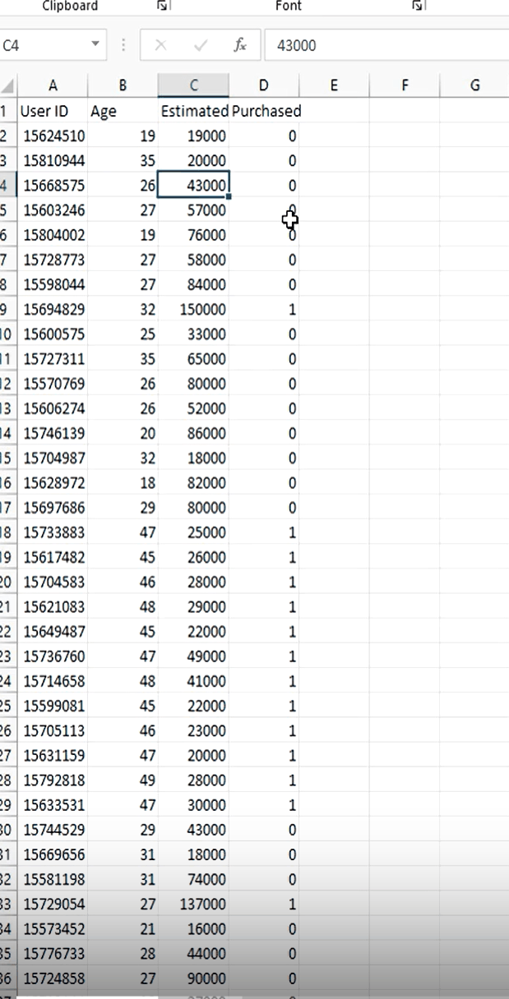 | 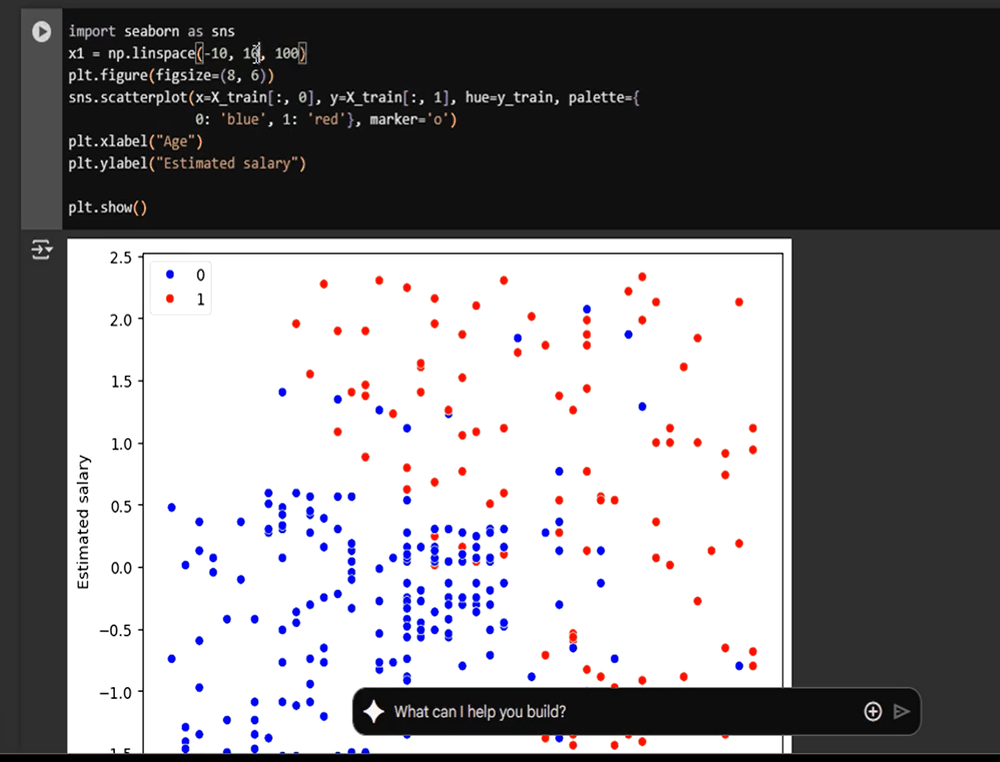 |

Features are standardised (`StandardScaler`) first — which is why the plots use roughly −3…3 axes — then two classifiers are compared:

- **KNN** — classifies by the majority label of the nearest neighbours; the decision boundary is jagged and non-linear. It must *store the whole training set*, which is expensive on a 16 KB device.
- **SVM** (`SVC(kernel='linear')`) — learns a single straight boundary. At inference time it is just **one weight vector and a bias per class**, so the model is tiny.

| KNN decision regions | Linear SVM decision boundary |
|---|---|
| 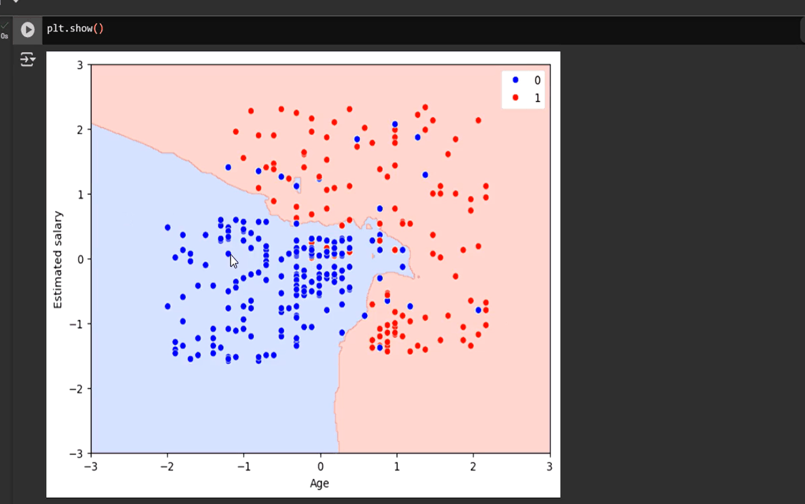 | 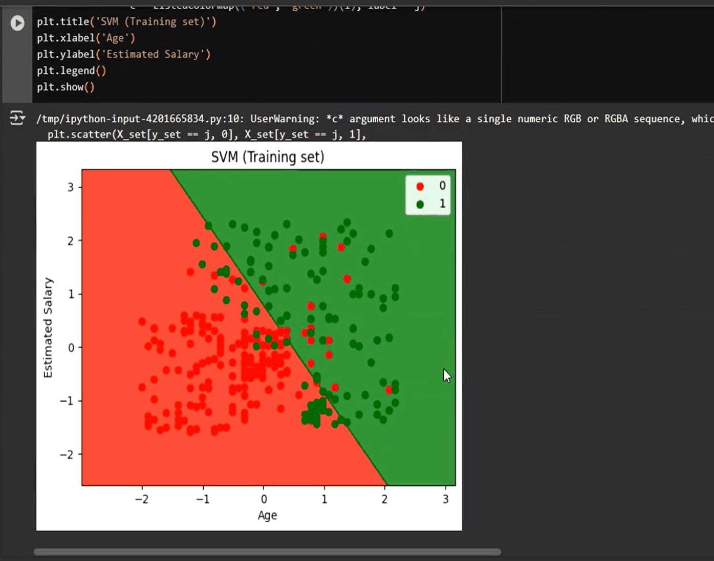 |

### SVM on the RISC-V board

The SVM weights, bias, and the scaler's mean and scale are exported into C headers (`svm_model.h`, `scaler.h`). On the board the program scales the input, takes a dot product per class, and returns the arg-max class — printed over UART/JTAG in the Freedom Studio terminal:

```c
void scale_input(double *x) {
    for (int i = 0; i < NUM_FEATURES; i++)
        x[i] = (x[i] - mean[i]) / scale[i];
}

int predict(float *x) {
    float max_score = -1e9; int best_class = -1;
    for (int c = 0; c < NUM_CLASSES; c++) {
        float score = bias[c];
        for (int i = 0; i < NUM_FEATURES; i++)
            score += weights[c][i] * x[i];
        if (score > max_score) { max_score = score; best_class = c; }
    }
    return best_class;
}
```

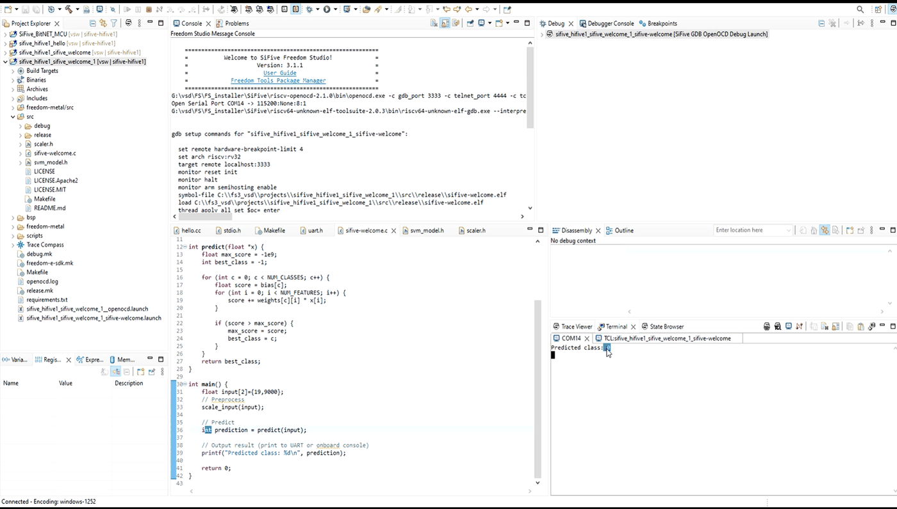

> The same `predict()` loop works for **any number of classes and features** — which is exactly what lets the next step (10-class MNIST) reuse the code.

---

## 5. Fitting MNIST into 16 KB

**MNIST** — 28×28 grayscale handwritten digits, 784 features per image, 10 classes — is the "hello world" of vision. The workshop's goal: classify it on a chip with 16 KB of RAM.

| Reference notebook (Kaggle) | Sample digits in Colab |
|---|---|
| 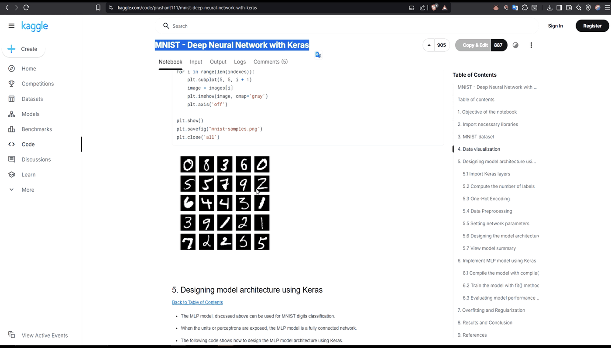 | 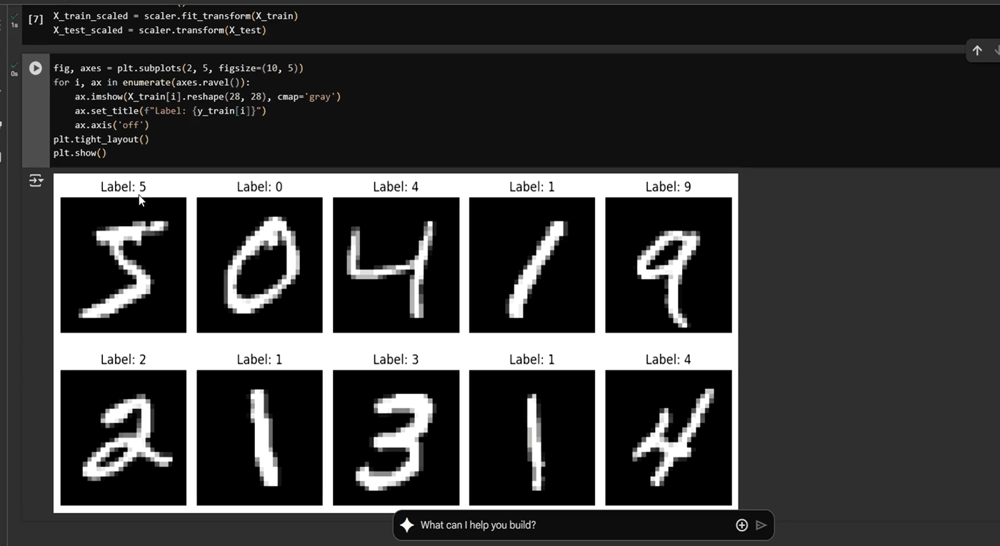 |

The linear SVM from Section 4 is trained on MNIST. The resulting **confusion matrix** is strongly diagonal:

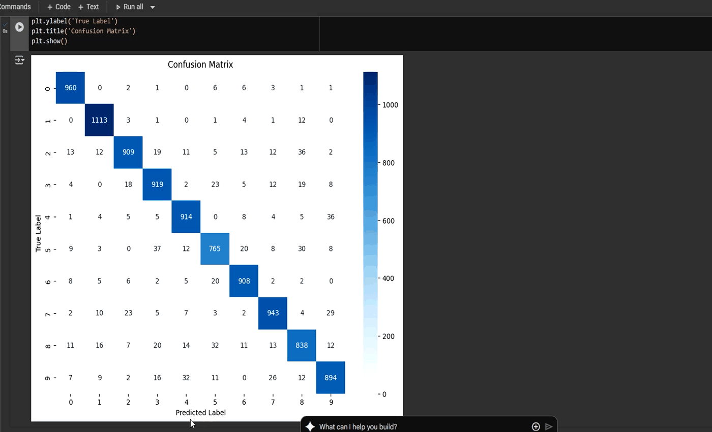

> From the diagonal (960 + 1113 + 909 + 919 + 914 + 765 + 908 + 943 + 838 + 894) ≈ **9,163 of 10,000** test digits are correct — roughly **91.6 %** (my own arithmetic from the screenshot). A plain linear model on raw pixels is not state of the art — but it is small enough to be a candidate for an MCU.

### The memory-math story

A 10-class linear model on 784 pixels needs 10 × 784 = **7,840 weights**. How many bytes that is depends entirely on the number format:

| Weight format | Bytes per weight | 7,840 weights |
|---|---|---|
| `double` (64-bit) | 8 | 62,720 B ≈ 61 KiB |
| `float` (32-bit) | 4 | 31,360 B ≈ 31 KiB |
| `int8_t` (8-bit) | 1 | **7,840 B ≈ 7.7 KiB** |
| RAM on the board | — | **16,384 B** |

*(Arithmetic is mine; sizes exclude biases, scaler constants, test images and stack.)*

The lab screenshots follow this exact journey. Each time the project is built, the linker (`ld`) reports by how much `region 'ram'` overflowed:

| Step | Screenshot | What the linker says |
|---|---|---|
| 1. Float/double model + test images | 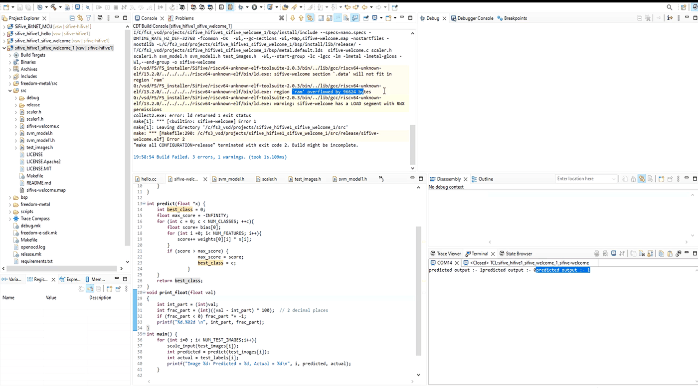 | `.data` will not fit — RAM overflowed by **96,624 bytes** |
| 2. Test data trimmed to one image (`NUM_TEST_IMAGES 1`) | 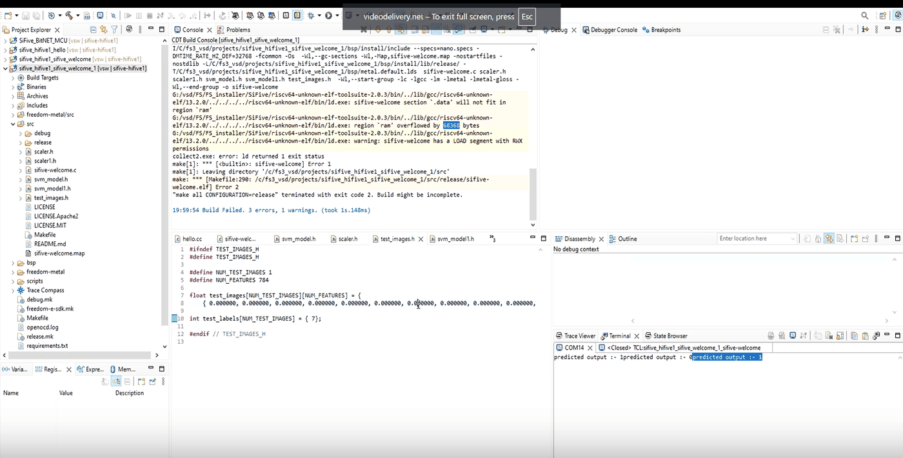 | RAM overflowed by **68,368 bytes** |
| 3. Quantize weights & test image to `int8_t` (`svm_model_q.h`, `test_images_q.h`) | 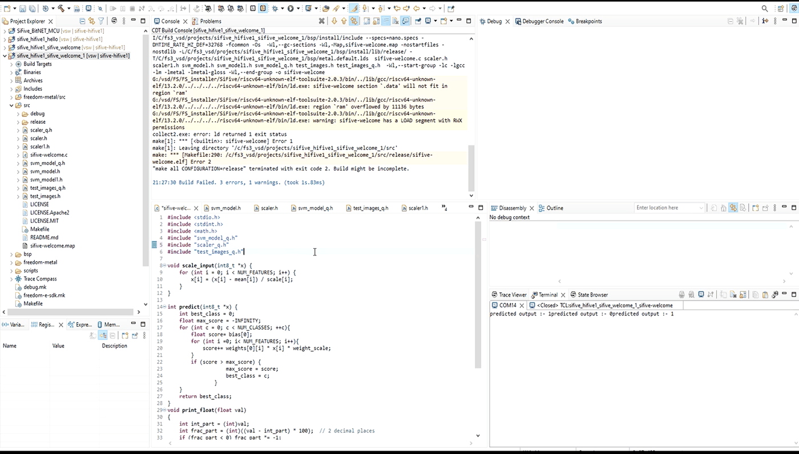 | RAM overflowed by **11,136 bytes** |
| 4. Quantize the scaler too (`scaler_q.h` with `mean_scale` / `scale_scale`) | 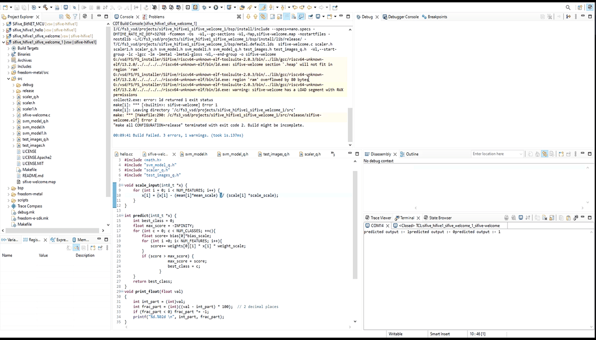 | only **80 bytes** over (now the `.heap` section) |
| 5. Fits! | 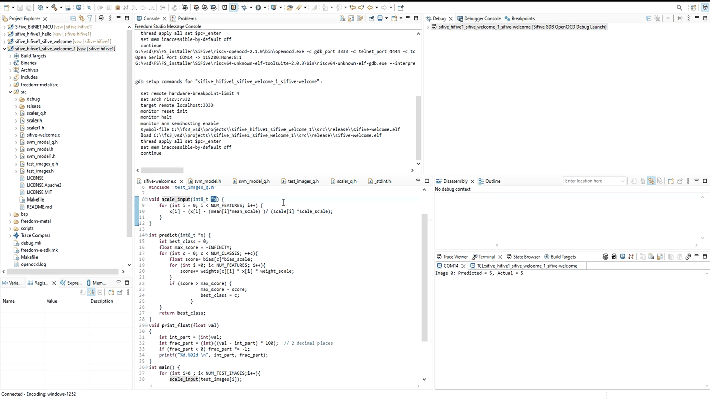 | Console prints `Image 0: Predicted = 5, Actual = 5` |

The official curriculum calls this *"68 KB → 16 KB compression"* — the 68,368-byte overflow in step 2 is a nice real-life instance of that gap.

#### Float weights → `int8` weights

The first header stores the model as `double weights[NUM_CLASSES][NUM_FEATURES]` with `NUM_CLASSES 10` and `NUM_FEATURES 784`. After quantization it becomes `const int8_t weights[...]` plus a single `weight_scale` and `bias_scale` — the inference loop multiplies int8 weights by int8 inputs and applies the scale once at the end. Declaring the tables `const` also lets the linker keep them in the QSPI flash instead of RAM.

| Before: `double` weights (`svm_model.h`) | After: `int8_t` weights + scale (`svm_model_q.h`) |
|---|---|
| 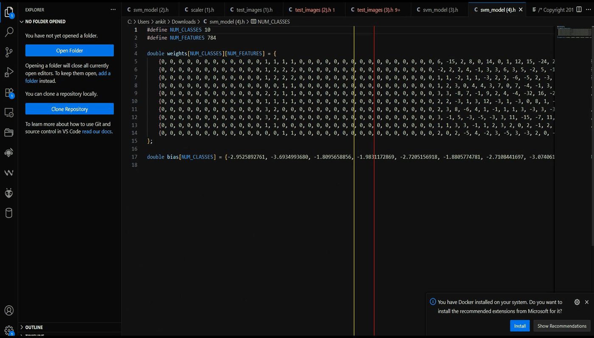 | 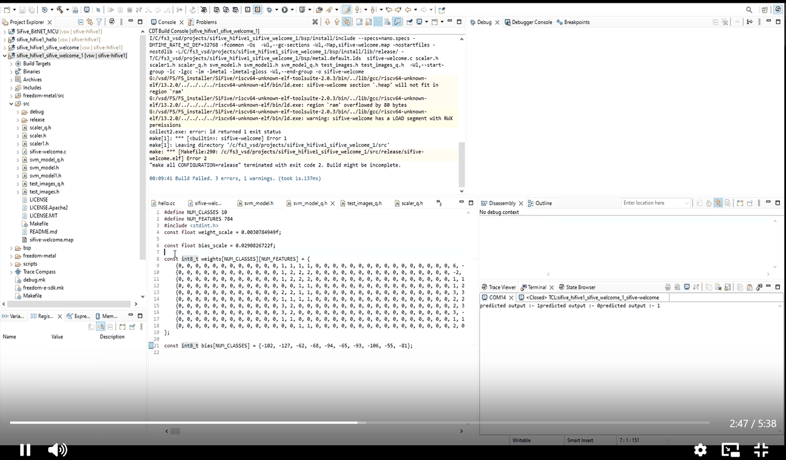 |

---

## 6. Quantization fundamentals

**Quantization** reduces numerical precision — typically from 32-bit floating point to a lower-bit representation — so a model needs less memory and less computation. In its simplest affine form:

```
q = round(x / s)        x ≈ s · q        (s = scale factor)
```

### Concepts

- Converts floating-point **weights and activations** to integer formats
- Reduces **memory footprint** and computational complexity significantly
- Aims to **maintain accuracy** while enabling efficient MCU deployment

Three approaches were covered:

| Approach | Idea |
|---|---|
| **Post-training quantization (PTQ)** | Quantize an already-trained model — fast, but accuracy can drop |
| **Quantization-aware training (QAT)** | Simulate low precision *during* training so the model adapts — best for ≤ 4 bits |
| **Dynamic quantization** | Adapt precision at run-time |

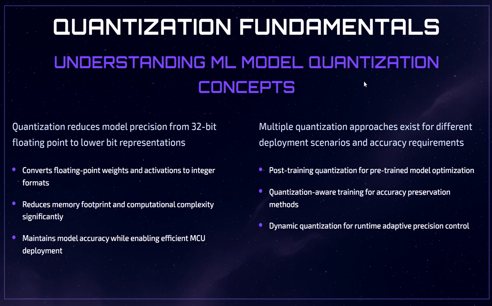

### Why MCUs need it

Microcontrollers typically have **32 KB – 1 MB of RAM**, limited flash and modest compute. That calls for aggressive compression and efficient algorithms.

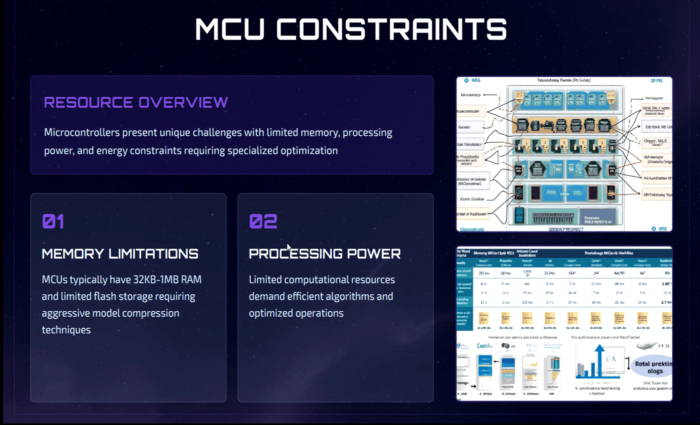

### Techniques

| Technique | What it does |
|---|---|
| **8-bit integer quantization** | Standard approach — float32 → int8, a 4× memory reduction and a big speed-up |
| **Mixed-precision quantization** | Different bit-widths per layer to balance accuracy and efficiency |
| **Sub-byte quantization** | 2–4 bits per parameter for extreme compression on severely constrained devices |

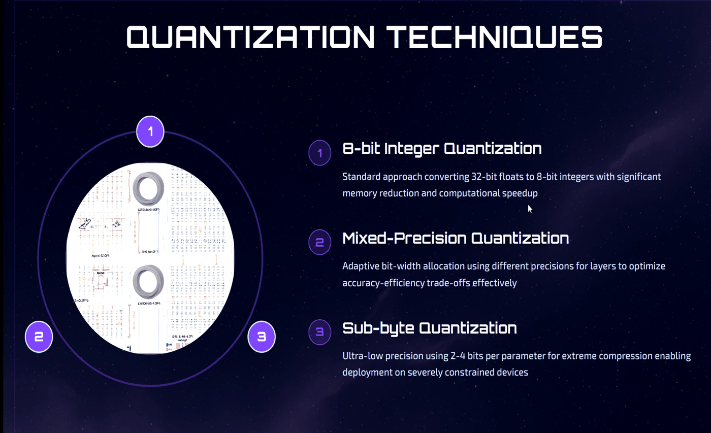

### Challenges

- **Accuracy loss** — numerical error needs careful calibration and validation
- **Hardware limits** — MCU instruction sets lack native support for mixed-precision operations, so packing/unpacking has to be done in software

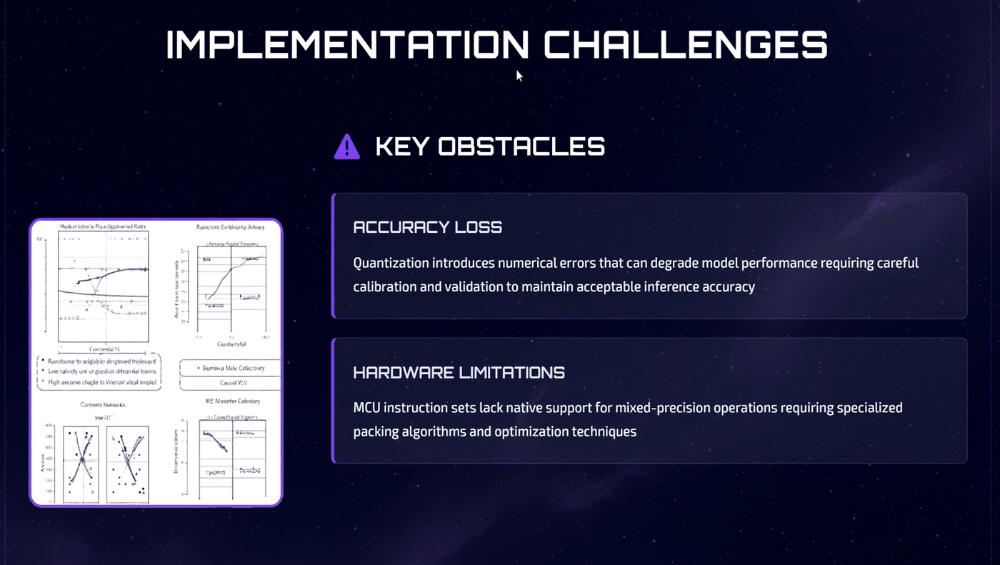

---

## 7. Neural networks

With linear models and quantization in place, the workshop moves on to neural networks.

### Biology → mathematics

The brain has around **86 billion neurons** linked by trillions of synapses. A neuron receives signals through **dendrites**, sums them in the cell body and sends output down the **axon**; **synapses** modulate the signal strength.

| Biological neurons | Neuron anatomy |
|---|---|
| 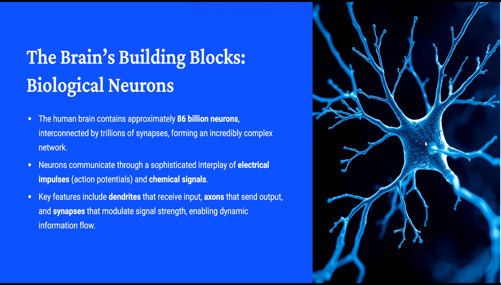 | 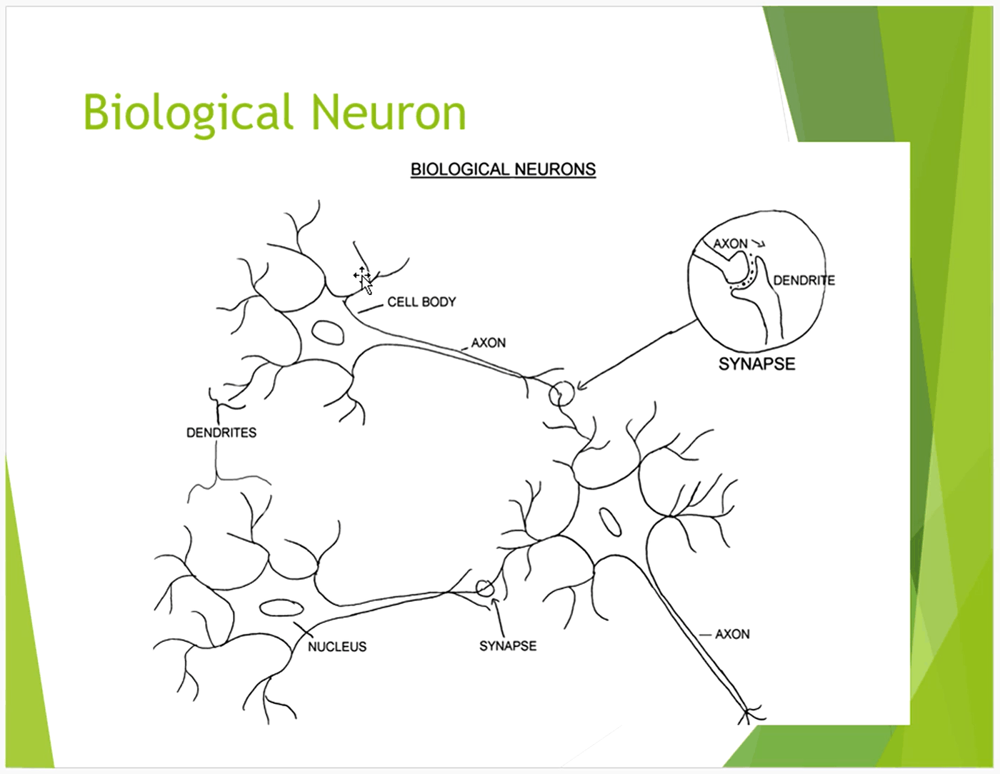 |

The **artificial neuron** copies that: inputs are multiplied by weights, summed (Σ), and passed through an **activation (transfer) function**:

```
y = f( x₁·w₁ + x₂·w₂ + … + xₙ·wₙ + b )
```

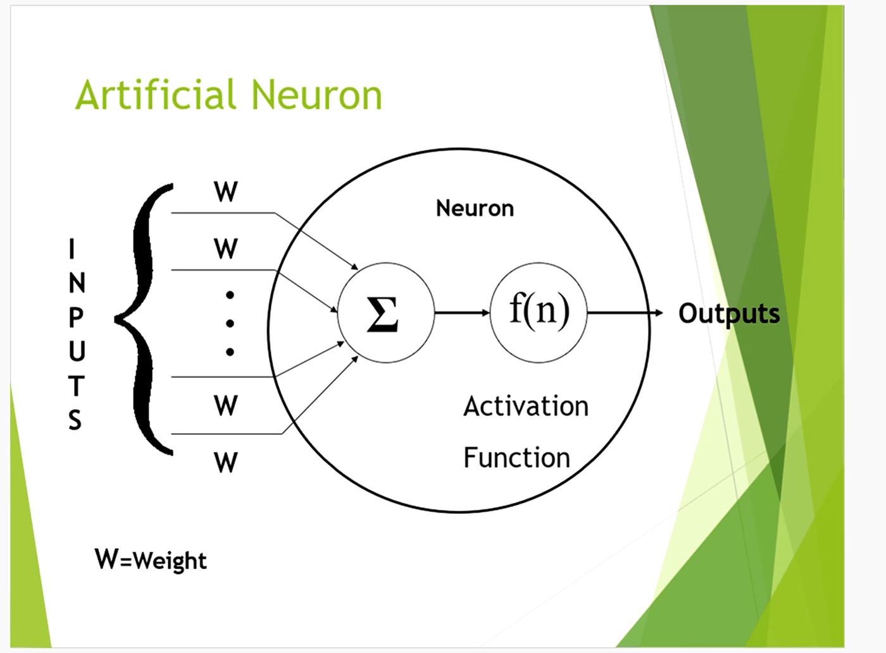

### Transfer functions

- **Sigmoid**: f(n) = 1 / (1 + e⁻ⁿ) — squashes any input into 0…1
- **Linear**: f(n) = n
- **ReLU** (handwritten on the Colab slide): f(n) = n for n > 0, otherwise 0 — cheap on an MCU: just a compare

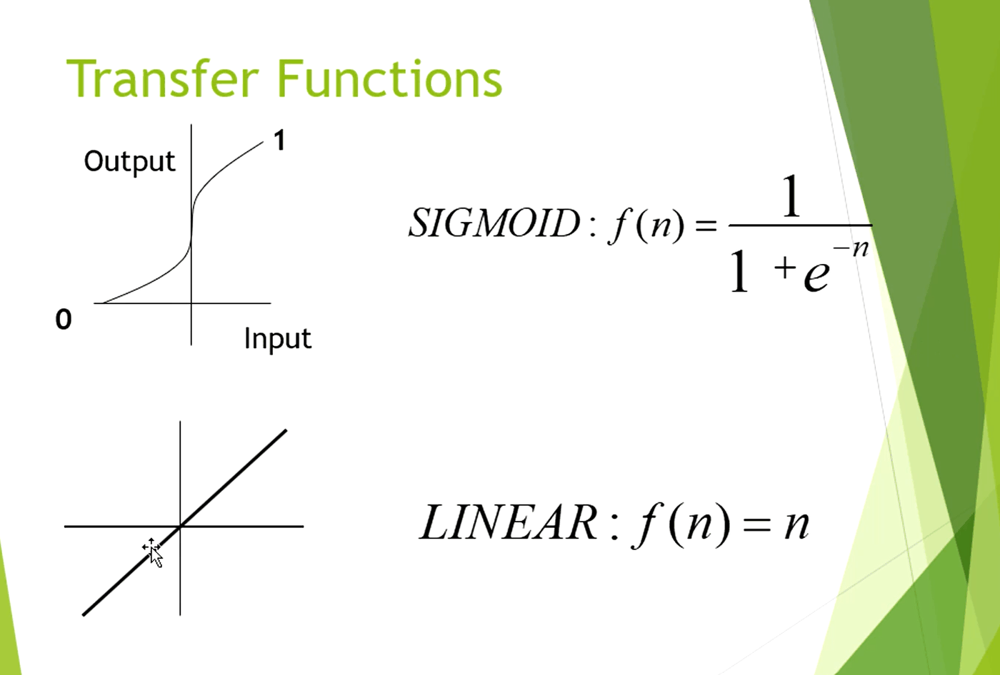

An *activation* is just a number between 0 and 1 — the brightness of a neuron. For a 28×28 image each pixel's grey value is an input activation:

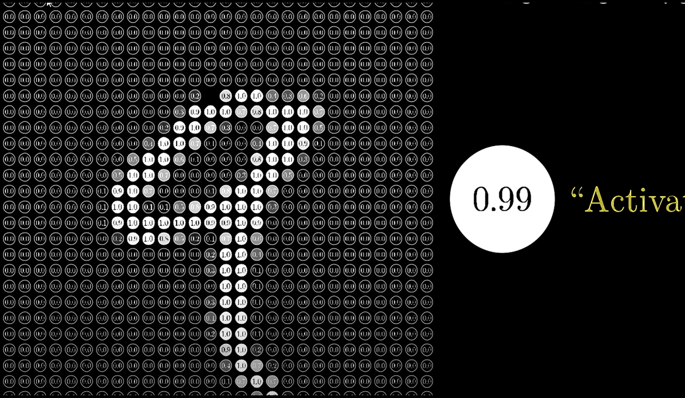

### From pixels to digits

A network for MNIST has **784 input neurons**, one or more **hidden layers**, and **10 output neurons** (digits 0–9). The brightest output is the prediction — here "9". The visuals in this part follow 3Blue1Brown's neural-network series (see [References](#references)).

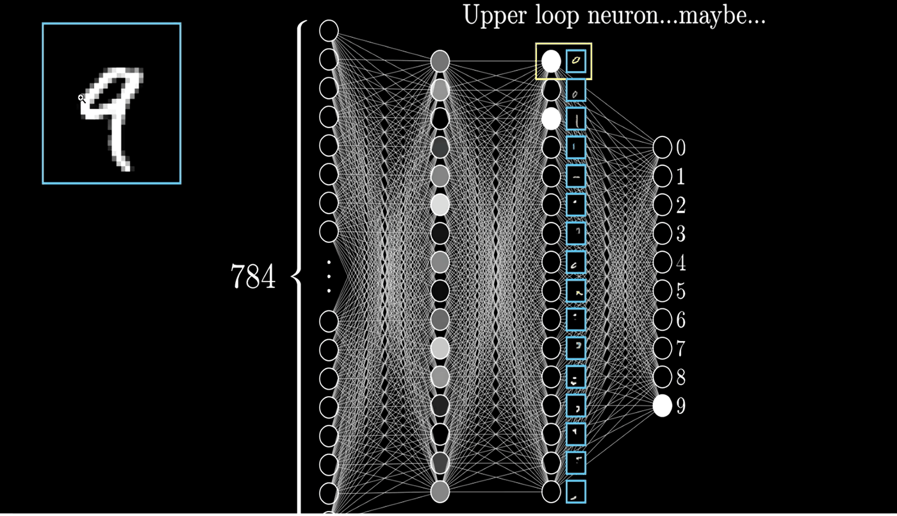

Each connection has a **weight**; one neuron computes a weighted sum of all 784 inputs. Positive weights (blue) boost, negative (red) suppress:

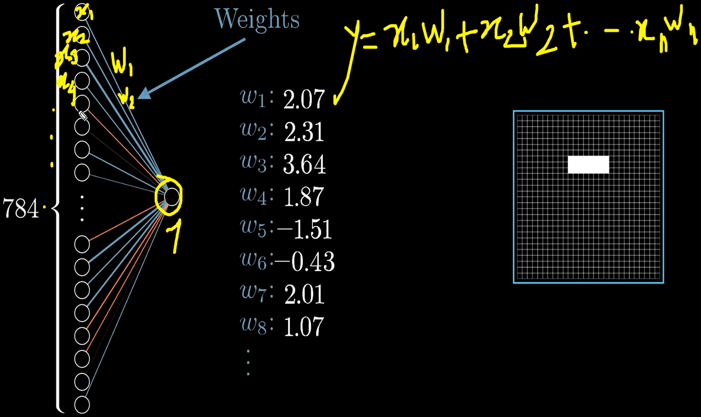

The hidden layers are the "?" — layers of intermediate features the network learns by itself:

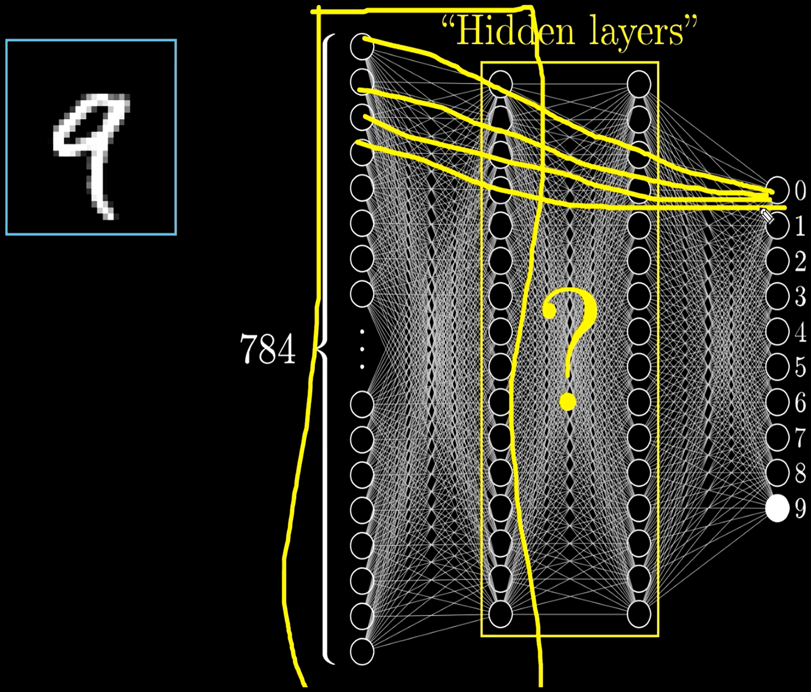

### An MLP in scikit-learn

The Colab notebook builds a small multi-layer perceptron on scikit-learn's `load_digits` set (8×8 images → **64 inputs**):

```python
from sklearn.datasets import load_digits
from sklearn.model_selection import train_test_split
from sklearn.neural_network import MLPClassifier

X, y = load_digits(return_X_y=True)
X_train, X_test, y_train, y_test = train_test_split(X, y, test_size=0.2, random_state=42)

mlp = MLPClassifier(hidden_layer_sizes=(64, 32), activation='relu',
                    solver='adam', max_iter=300)
mlp.fit(X_train, y_train)
```

The instructor's annotations show the shape **64 → 64 → 32 → 10**.

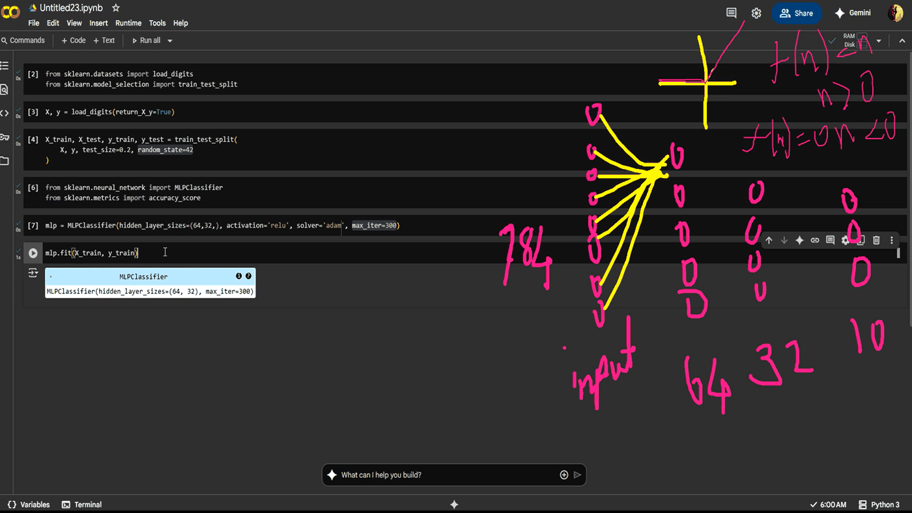

> **Memory check (my arithmetic).** 64→64→32→10 has 64·64+64 + 64·32+32 + 32·10+10 = **6,570 parameters** ≈ 6.4 KB as `int8` — comfortably inside 16 KB. A full-size 784→64→32→10 MLP has **52,650 parameters** ≈ 51 KB even at 8-bit — it does *not* fit. That gap is exactly why the next section combines **smaller inputs and lower-bit weights**.

---

## 8. BitNetMCU: low-bit neural networks on hardware

The advanced quantization module uses **BitNetMCU** — an open-source project that trains low-bit quantized, fully-connected MNIST networks for very cheap RISC-V microcontrollers. Key ideas from the project's documentation:

- **Quantization-aware training** with a straight-through estimator; weights are quantized on the fly during training
- Weight formats from 1-bit and ternary up to 8-bit; **4-bit** is the sweet spot — the original project reports **~99 % MNIST accuracy in ~12 KB** of model data on a CH32V003
- **Images downscaled** to 16×16 to save memory, and **data augmentation** (small rotations/shifts) to improve accuracy
- Multiplication-light inference — bit-packed weights and shift-based normalisation

The workshop adapts it: a project named `SEMICON2024_Quantized_AI_Model` (shown at SEMICON 2024 by the VSD team) with three stages — **training** (`training.py`, `trainingparameters.yaml`, `exportquant.py`), **camera interfacing** (OV7670 camera firmware) and **prediction** (on-board inference).

### Training configuration

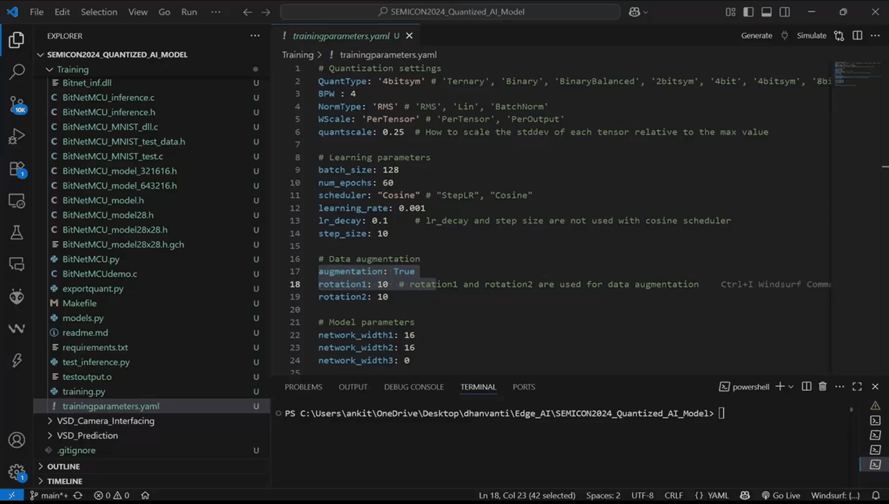

| Parameter | Value in the screenshot |
|---|---|
| `QuantType` / `BPW` | `4bitsym` / 4 bits per weight |
| `NormType` / `WScale` | `RMS` / `PerTensor` |
| `quantscale` | 0.25 |
| `batch_size` / `num_epochs` | 128 / 60 |
| `scheduler` / `learning_rate` | Cosine / 0.001 |
| Augmentation | on — `rotation1`, `rotation2` = 10° |
| `network_width1` / `width2` / `width3` | 16 / 16 / 0 |

### Real-time demo: camera → MCU → 7-segment

The end-to-end demo uses two **VSDSquadron Mini** boards: one reads an **OV7670 camera** (*"Camera Input"*) and streams the image over UART; the other runs the quantized network and shows the digit on a 7-segment display (*"Compute Result"*).

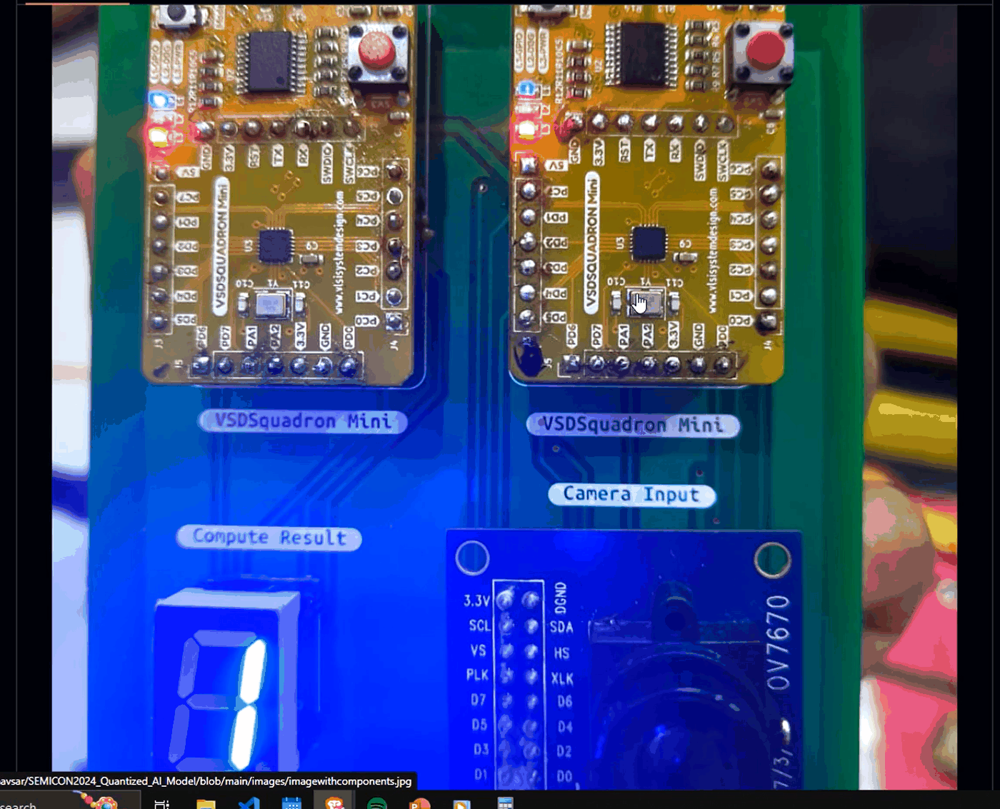

### Running the model in Freedom Studio

The trained model is exported as a C header (`BitNetMCU_model_12k.h`, ~12 KB) containing test samples with 256 values each (16×16). A new Freedom Studio project is created from the example wizard; the firmware loops over `BitMnistInference(...)` and prints the prediction and label over the serial port.

| Create the MNIST project | Inference output on the board |
|---|---|
| 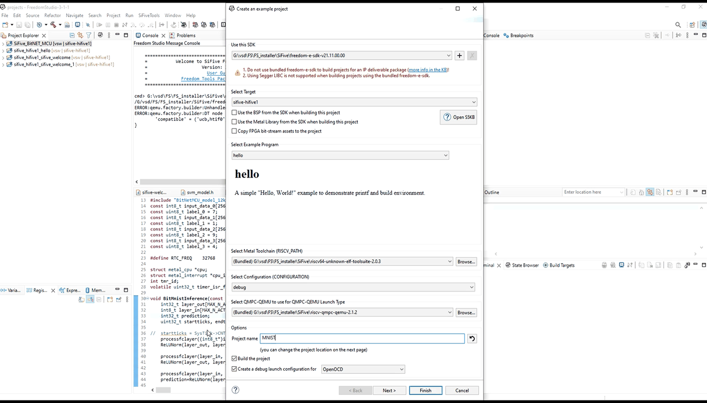 | 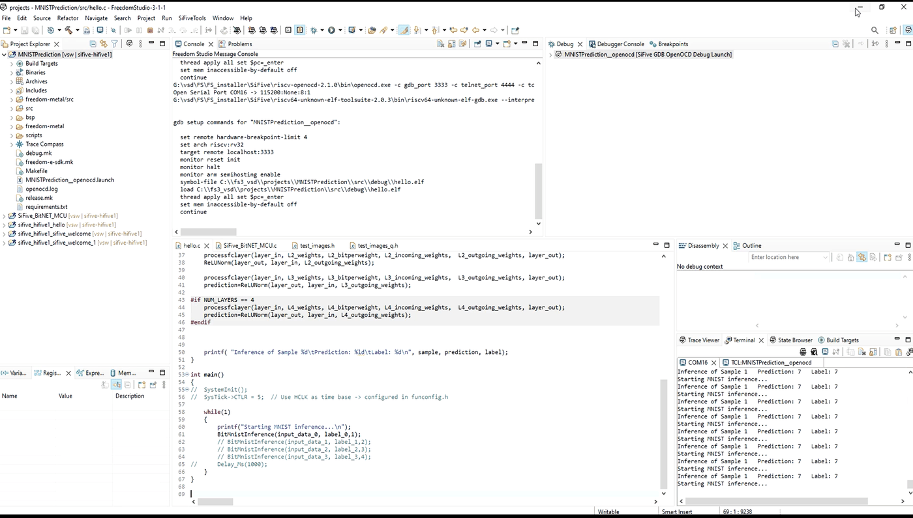 |

*Repeated lines read `Inference of Sample 1  Prediction: 7  Label: 7` — the quantized network classifies the test digit correctly, run after run.*

---

## 9. No board, no problem — running on QEMU

Not everyone has the board at hand. Freedom Studio ships with a **QEMU** RISC-V machine (`qemu-sifive-e31`), so the same C code can be built, debugged and run on a laptop.

### Step by step

1. Open **Freedom Studio** and use *SiFiveTools ▸ Create a Software Example Project ▸ Create a new Freedom SDK for Metal Software Project*.

   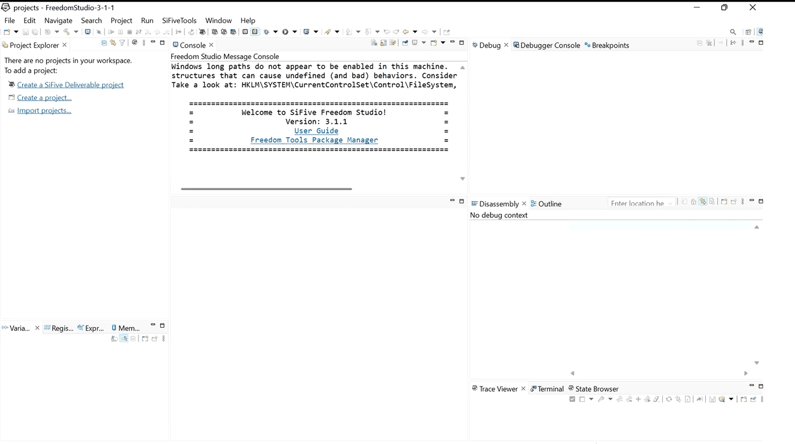

   

2. Select target **`qemu-sifive-e31`**, the *sifive-welcome* example, and set *Create a debug launch configuration for* → **QEMU**.

   

3. The first build **fails**. Newer GCC/binutils (the console shows toolchain 13.2.0) no longer include the CSR and fence.i instructions in the base `rv32imac` target.

   

4. In `bsp/settings.mk` change the architecture to **`RISCV_ARCH = rv32imac_zicsr_zifencei`** (ABI stays `ilp32`) and rebuild. This is the usual fix for this class of error.

   

5. Open *Debug Configurations* and run the **SiFive GDB QEMU Debugging** entry for the project.

   

6. The debugger halts at `main()` — you can single-step through C and RISC-V disassembly (`lui`, `addi`, `jal`, `sw`, …) and watch the variables.

   

7. Resume: QEMU prints the SiFive welcome banner on the console.

   

---

## 10. Key takeaways

1. **Training and inference are different problems.** Train on a PC (Python, floats); deploy the *result* as C constants and a few loops.
2. **Memory, not compute, is the first wall.** 7,840 weights are 61 KiB as `double` but under 8 KiB as `int8` — the difference between failing to link and running.
3. **Read the linker.** The `region 'ram' overflowed by N bytes` message is the progress bar for model compression.
4. **Quantization-aware training beats post-training quantization** at low bit-widths — 4-bit models can stay close to full-precision accuracy.
5. **Shrink everything**: input resolution (28×28 → 16×16), bit-width, number of layers/neurons, and `printf`-style library code.
6. **Linear models are the cheapest edge classifiers**; small MLPs with low-bit weights are the next step up.
7. **Simulate first.** QEMU lets you validate toolchains and code without hardware.

### Workshop projects and labs (from the official curriculum)

*Projects:* Startup Profit Predictor · Edge KNN/SVM Classifier · MNIST on 16 KB RAM · Neural Network Memory Optimization · Capstone: Real-Time Edge AI
*Labs:* Gradient Descent · KNN on Edge · SVM Digit Recognition · Neural Network Compression · Quantization-Aware Training · Real-Time Inference Benchmark

---

## Repository layout

```
.
├── README.md        # this file
└── images/          # 57 screenshots, numbered in the order they appear above
    ├── 01-programming-logic-vs-learning.png
    ├── …
    └── 57-qemu-sifive-banner-output.png
```

Image files are named `NN-short-description.png`, where `NN` follows the order of appearance in this README.

## References

**Workshop and hardware**
- VSD — [RISC-V EdgeAI workshop page](https://www.vlsisystemdesign.com/riscv_edgeai/) (curriculum, modules, instructors, tools)
- Electronics For You — [VSD launches VSDSquadron with IIT Madras & DIR-V](https://www.electronicsforu.com/press-releases/innovation-education-unite-vsd-launches-vsdsquadron-in-collaboration-with-iit-madras-dir-v)
- SiFive — [FE310-G002 datasheet](https://pages.hmc.edu/harris/class/e85/old/fall24/fe310-g002-ds.pdf) (mirror hosted by Harvey Mudd College)
- [Zadig](https://zadig.akeo.ie/) USB driver installer
- FreeRTOS — [RTOS demo for RISC-V QEMU `sifive_e` in Freedom Studio](https://freertos.org/Documentation/02-Kernel/03-Supported-devices/04-Demos/Others/RTOS-RISC-V-FreedomStudio-QMEU)

**Quantization and edge models**
- cpldcpu — [BitNetMCU documentation](https://github.com/cpldcpu/BitNetMCU/blob/main/docs/documentation.md) · [CNX Software article](https://www.cnx-software.com/2024/05/08/bitnetmcu-machine-learning-ch32v003-risc-v-mcu-high-accuracy/)
- dhanvantibhavsar — [SEMICON2024_Quantized_AI_Model](https://github.com/dhanvantibhavsar/SEMICON2024_Quantized_AI_Model) (VSDSquadron Mini + OV7670 camera + BitNetMCU)

**Neural-network background (visuals appear to follow these)**
- 3Blue1Brown — [But what is a neural network? (Deep learning, chapter 1)](https://www.youtube.com/watch?v=aircAruvnKk)
- Kaggle — [MNIST – Deep Neural Network with Keras](https://www.kaggle.com/code/prashant111/mnist-deep-neural-network-with-keras)
- [Desmos graphing calculator](https://www.desmos.com/calculator) — used for the interactive regression demos

---

*Notes compiled by Bhuvan Kusuma from workshop session screenshots, enriched with the official workshop page and the public references above. Corrections and pull requests are welcome.*
